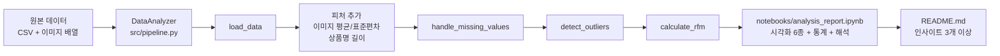
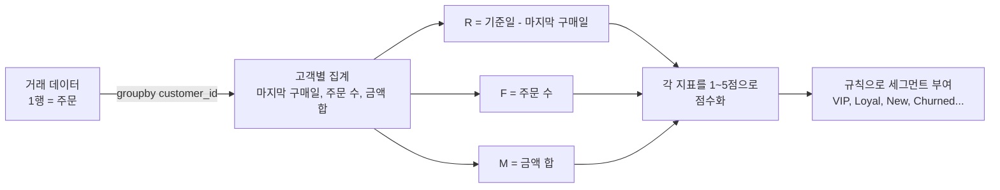

# A1-1 개념 정리 — 멀티모달 EDA와 RFM 고객 세분화

이 문서는 [A1-1 과제](../subject.md)를 혼자 해내는 데 필요한 개념을 처음부터 설명한다. 정답 코드를 주는 문서가 아니라, **왜 그렇게 계산하는지**를 이해해서 스스로 코드를 짤 수 있게 만드는 문서다. 실제 작업 순서는 [단계별 실습 가이드](WALKTHROUGH.md)를 본다.

각 절은 같은 순서로 구성한다.

1. 일상 비유로 감 잡기
2. 정확한 정의와 공식
3. 손으로 해 보는 작은 계산
4. 과제에서 어디에 쓰는지
5. 자주 하는 오해

## 읽는 순서

| 순서 | 배울 내용 | 이걸 알면 할 수 있는 일 |
| --- | --- | --- |
| 0 | 과제 전체 흐름 | 결과물 3개(`src/pipeline.py`, 노트북, README)가 어떻게 이어지는지 설명하기 |
| 1 | 데이터 유형과 데이터의 단위 | 내 데이터셋이 "1,000건 이상, 8컬럼 이상, 3유형 이상" 조건을 만족하는지 판정하기 |
| 2 | NumPy 배열, shape, axis, 벡터화 | for 문 없이 여러 이미지의 통계를 한 번에 계산하기 |
| 3 | 이미지 = 숫자 배열 | 이미지에서 평균·표준편차 피처를 뽑고 의미를 해석하기 |
| 4 | 텍스트 파생 변수 | 상품명에서 글자 수·단어 수 컬럼 만들기 |
| 5 | Pandas로 데이터 구조 파악 | `info()`, `describe()`, `head()` 결과를 읽고 해석 문장 쓰기 |
| 6 | 결측치와 그룹별 대치 | 카테고리별 중앙값으로 빈칸 채우기 |
| 7 | 기술통계 | 평균·중앙값·표준편차·사분위수를 계산하고 차이를 해석하기 |
| 8 | IQR 이상치 탐지 | 이상치 경계를 직접 계산하고 처리 전후 분포 비교하기 |
| 9 | 상관계수 | 두 변수의 관계를 수치로 말하고 한계를 설명하기 |
| 10 | 시각화 6종 | 질문에 맞는 차트를 고르고 제목·축 레이블 붙이기 |
| 11 | 날짜와 시계열 집계 | 월별 매출 라인차트 만들기 |
| 12 | RFM 분석 | 고객별 R·F·M 점수를 매기고 4개 이상 세그먼트로 나누기 |
| 13 | 클래스로 파이프라인 만들기 | `DataAnalyzer`를 설계하고 노트북에서 재사용하기 |
| 14 | 해석과 비즈니스 인사이트 | "근거·실행·검증" 형식의 인사이트 쓰기 |

처음이라면 0~5를 먼저 읽고 데이터를 불러와 본 뒤, 6~11을 읽으며 EDA를 진행한다. 12~14는 EDA가 끝난 뒤 읽어도 늦지 않다.

---

## 0. 과제 전체 흐름

**비유**: 식당 주방을 생각한다. 재료(원본 데이터)가 들어오면 손질(전처리)하고, 썰고 양념해서(피처 엔지니어링) 요리를 낸다. 요리사가 매번 즉흥으로 만들면 맛이 들쭉날쭉하니, 손질 순서를 **레시피(클래스)**로 정리해 둔다. 손님(의사결정자)에게는 요리 사진과 설명이 담긴 **메뉴판(노트북·README)**을 보여 준다.



| 결과물 | 역할 | 비유 |
| --- | --- | --- |
| `src/pipeline.py` | 계산 로직을 담은 `DataAnalyzer` 클래스 | 레시피 |
| `notebooks/analysis_report.ipynb` | 클래스를 불러 실행하고, 차트와 마크다운 해석을 보여 줌 | 조리 과정 사진첩 |
| `README.md` | 개요, 데이터 설명, 인사이트 3개 이상, 실행 방법 | 메뉴판 |

**자주 하는 오해**: "노트북에 다 짜고 마지막에 클래스로 옮기면 된다." 그렇게 해도 되지만, 노트북 셀마다 변수를 덮어쓰다 보면 실행 순서가 꼬인다. 처음부터 계산은 클래스에, 보여 주기는 노트북에 두는 습관이 과제 의도(재사용 가능한 코드)에 맞다.

---

## 1. 데이터 유형과 데이터의 단위

### 1.1 데이터 유형

**비유**: 이력서를 떠올린다. 나이는 숫자, 학과는 정해진 보기 중 하나, 입사일은 날짜, 자기소개는 자유 글, 증명사진은 이미지다. 같은 사람에 대한 정보지만 다루는 방법이 모두 다르다. 이렇게 여러 형태가 섞인 데이터를 **멀티모달(multi-modal) 데이터**라고 한다.

| 유형 | 예 | Pandas에서의 모습 | 주로 하는 계산 |
| --- | --- | --- | --- |
| 수치형 | 가격, 수량, 평점 | `int64`, `float64` | 평균, 표준편차, 상관 |
| 범주형 | 카테고리, 국가 | `object` 또는 `category` | 빈도, 그룹별 집계 |
| 날짜형 | 등록일, 주문일 | `datetime64[ns]` | 기간 계산, 월별 집계 |
| 텍스트 | 상품명 | `object`(문자열) | 길이, 단어 수 |
| 이미지(배열) | 상품 사진 | NumPy 배열(또는 배열을 문자열로 저장한 컬럼) | 픽셀 평균, 표준편차 |

과제 조건은 "수치형, 범주형, 날짜형, 이미지(배열) 중 **최소 3가지 이상**"이다. 텍스트(상품명)는 피처 엔지니어링 요구사항(4-3)에서 별도로 다룬다.

**자주 하는 오해**: CSV에서 읽은 날짜는 자동으로 날짜형이 되지 않는다. `info()`에서 `object`로 보이면 아직 문자열이다. `pd.to_datetime()`으로 바꿔야 날짜 계산이 된다.

### 1.2 데이터의 단위(grain)

한 행이 무엇을 뜻하는지를 **단위(grain)**라고 한다.

- 상품 테이블: 1행 = 상품 1개 (상품명, 가격, 카테고리, 등록일, 이미지)
- 거래 테이블: 1행 = 주문 1건 또는 주문 품목 1개 (customer_id, order_date, amount)
- RFM 테이블: 1행 = 고객 1명 (Recency, Frequency, Monetary)

RFM은 **거래 단위 데이터를 고객 단위로 묶는(groupby) 작업**이다. 과제는 RFM용 거래 데이터에 최소 `customer_id`, `order_date`, `amount`(또는 `price * qty`) 컬럼이 있어야 한다고 정한다. 상품 테이블과 거래 테이블이 따로 있다면 상품 ID로 합칠(`merge`) 수 있다.

**자주 하는 오해**: "행 수 = 고객 수"라고 생각하기 쉽다. 거래 데이터 10,000행이 고객 800명일 수 있다. Frequency를 셀 때 같은 주문 번호의 여러 품목을 각각 세면 빈도가 부풀려진다. 주문 번호 컬럼이 있다면 `nunique()`로 고유 주문 수를 세는 편이 정확하다.

---

## 2. NumPy 배열과 벡터화

### 2.1 배열, shape, axis

**비유**: 달걀판을 생각한다. 달걀판 한 장은 가로·세로가 있는 2차원 격자다. 달걀판을 여러 장 쌓으면 3차원이 된다. NumPy 배열(`ndarray`)은 같은 종류의 숫자를 이런 격자에 담은 것이다.

- `shape`: 각 방향의 크기. 달걀판 10장, 각 판이 5×6이면 `(10, 5, 6)`
- `axis`: 어느 방향으로 계산할지. `axis=0`은 첫 번째 방향(판 번호), `axis=1`은 세로, `axis=2`는 가로

```python
import numpy as np
a = np.array([[1, 2, 3],
              [4, 5, 6]])    # shape (2, 3)
a.mean(axis=0)   # 세로로 눌러서 열마다 평균 -> [2.5, 3.5, 4.5]
a.mean(axis=1)   # 가로로 눌러서 행마다 평균 -> [2., 5.]
```

`axis=k`로 계산하면 **그 축이 사라진다**고 기억하면 쉽다. `(2, 3)`에 `axis=0`을 주면 결과 shape은 `(3,)`이다. 여러 축을 한꺼번에 없앨 수도 있다: `axis=(1, 2)`.

### 2.2 벡터화(Vectorization)

**비유**: 시험지 100장을 채점할 때, 한 장씩 집어 들어 점수를 적는 것이 for 문이다. 답안지를 모두 겹쳐 놓고 OMR 기계에 한 번에 넣는 것이 벡터화다.

**정의**: 원소 하나하나를 파이썬 반복문으로 처리하지 않고, 배열 전체에 대한 연산 한 번으로 표현하는 방식이다. 실제 반복은 NumPy 내부의 C 코드가 처리하므로 훨씬 빠르고 코드도 짧다.

**하드웨어 원리 (SIMD: Single Instruction Multiple Data)**:
NumPy의 벡터화가 파이썬 for 문보다 수십~수백 배 빠른 근본적인 이유는 CPU의 **SIMD** 명령어를 활용하기 때문이다.
- 일반적인 파이썬 for 문은 숫자를 하나씩 가져와 더하는 **SISD(단일 명령 단일 데이터)** 방식으로 동작하여 오버헤드가 크다.
- 반면 SIMD는 CPU의 특수 레지스터(Intel/AMD의 AVX, Apple Silicon의 ARM NEON 등)를 사용하여 **단 하나의 CPU 명령어(Single Instruction)로 여러 개의 데이터(Multiple Data, 예: 4~16개의 실수)를 동시에 병렬 계산**한다.
- 따라서 이번 과제에서 "for 문 없이 배열 연산으로 계산하라"는 요구는 단순한 코드 간결성을 넘어, 현대 하드웨어의 **SIMD 병렬 처리 성능을 온전히 이끌어내는 데이터 파이프라인**을 구축하라는 의미다.

```python
prices = np.array([10000, 25000, 8000])
qty    = np.array([2, 1, 5])
amount = prices * qty          # [20000, 25000, 40000] — 원소끼리 곱
```

**브로드캐스팅**: shape이 다른 배열끼리 계산할 때 작은 쪽을 자동으로 늘려 맞춰 주는 규칙이다. `(N, H, W)` 배열에서 각 이미지의 평균(shape `(N,)`)을 빼려면 `(N, 1, 1)`로 모양을 바꿔야 맞는다.

```python
imgs.shape                                   # (N, H, W)
means = imgs.mean(axis=(1, 2))               # (N,)
centered = imgs - means[:, None, None]       # (N, H, W) - (N, 1, 1)
```

**과제 연결**: 요구사항 4-3은 이미지 평균·표준편차를 "반복문(for loop) 대신 배열 연산"으로 계산하라고 명시한다. 즉 이미지를 하나의 큰 배열로 쌓은 뒤 `axis`를 지정해 한 번에 계산해야 한다.

**자주 하는 오해**

- `df['img'].apply(np.mean)`은 for 문이 아닌 것처럼 보이지만, 내부적으로 행마다 파이썬 함수를 호출하는 반복이다. 과제 의도인 "배열 연산"과 거리가 있다.
- 크기가 다른 이미지들은 하나의 배열로 쌓을 수 없다(`np.stack`이 오류를 낸다). 먼저 크기를 통일해야 한다(3.3절).

---

## 3. 이미지 = 숫자 배열

### 3.1 픽셀과 채널

**비유**: 모자이크 타일 그림이다. 멀리서 보면 사진이지만 가까이 보면 색칠된 작은 타일의 격자다. 타일 하나가 **픽셀**이고, 타일의 밝기가 숫자다.

| 종류 | shape | 값의 의미 |
| --- | --- | --- |
| 흑백(grayscale) | `(H, W)` | 픽셀 하나에 밝기 1개 |
| 컬러(RGB) | `(H, W, 3)` | 픽셀 하나에 빨강·초록·파랑 3개 |
| 컬러+투명도(RGBA) | `(H, W, 4)` | RGB + 투명도 |

값의 범위는 저장 방식에 따라 다르다. `uint8`이면 0~255, 실수형이면 보통 0.0~1.0이다. `matplotlib.pyplot.imread()`로 PNG를 읽으면 0.0~1.0 실수 배열이 나온다. 범위가 다른 이미지가 섞이면 평균을 비교할 수 없으므로 한 가지로 통일한다.

RGB를 흑백으로 바꿀 때는 채널 평균을 내거나, 사람 눈의 민감도를 반영한 가중합을 쓴다.

$$
\text{gray} = 0.299R + 0.587G + 0.114B
$$

NumPy로는 `rgb @ np.array([0.299, 0.587, 0.114])`처럼 마지막 축과 내적하면 된다.

### 3.2 이미지 통계 피처: 평균과 표준편차

- **평균(Mean)**: 이미지 전체가 얼마나 밝은가 (밝기)
- **표준편차(Std)**: 픽셀 밝기가 얼마나 들쭉날쭉한가 (대비, contrast)

**손계산 예제**: 2×2 흑백 이미지 두 장

```text
이미지 A          이미지 B
[[  0, 100],      [[100, 100],
 [200, 100]]       [100, 100]]
```

- A 평균 = (0 + 100 + 200 + 100) / 4 = 100
- A 분산 = ((0-100)² + 0² + (200-100)² + 0²) / 4 = 20000 / 4 = 5000, 표준편차 = √5000 ≈ 70.71
- B 평균 = 100, 표준편차 = 0

두 이미지는 밝기가 같지만, A는 대비가 크고 B는 단색이다. 평균만으로는 구분되지 않던 차이를 표준편차가 잡아낸다. 이것이 "이미지를 수치형 피처로 바꾼다"는 말의 뜻이다.

두 장을 쌓은 배열 shape은 `(2, 2, 2)`이고, `axis=(1, 2)`로 평균을 내면 `[100., 100.]`, 표준편차는 `[70.71, 0.]`이 한 번에 나온다.

**자주 하는 오해**: NumPy의 `np.std()`는 기본값이 모집단 표준편차(`ddof=0`, n으로 나눔)이고, Pandas의 `Series.std()`는 표본 표준편차(`ddof=1`, n-1로 나눔)다. 같은 데이터인데 값이 다르게 나오면 이것 때문이다. 어느 쪽을 썼는지 마크다운에 적어 두면 된다.

### 3.3 크기 통일과 다운샘플링

과제의 이미지 처리 허용 범위는 다음과 같다.

| 작업 | 허용 방법 |
| --- | --- |
| 입력/변환 | `imread()`로 읽고, 반환된 NumPy 배열을 직접 조작 |
| 저장/복구 | CSV에 문자열로 저장된 배열은 `np.fromstring()` 또는 `ast.literal_eval()`로 복구 |
| 리사이즈 | NumPy 슬라이싱 `arr[::n, ::n]`으로 단순 다운샘플링 |

`arr[::2, ::2]`는 행과 열을 하나 건너 하나씩 고른다. 64×64 이미지가 32×32가 된다. 크기가 서로 다르면 가운데를 잘라(크롭) 같은 크기로 맞춘 뒤 다운샘플링하는 방법도 슬라이싱만으로 할 수 있다.

**OpenCV, Pillow 같은 이미지 전용 라이브러리는 금지**다. `cv2.resize`, `Image.open`을 쓰면 안 된다.

### 3.4 CSV 안의 배열 문자열

CSV는 표 형식이라 배열을 그대로 담지 못한다. 그래서 `"[0.1, 0.5, 0.3]"` 같은 문자열로 저장되는 경우가 많다.

```python
import ast
ast.literal_eval("[[0, 100], [200, 100]]")        # 파이썬 리스트로 복구
np.fromstring("0 100 200 100", sep=" ")           # 공백 구분 숫자열 -> 1차원 배열
```

복구한 1차원 배열은 `reshape(H, W)`로 원래 모양을 되돌린다. 이 복구는 행마다 문자열을 파싱하므로 반복이 불가피하다. 과제가 "배열 연산"을 요구하는 대상은 **복구 이후의 평균·표준편차 계산**이다.

---

## 4. 텍스트 파생 변수

**비유**: 책 제목이 긴 책과 짧은 책을 비교하는 것과 같다. 제목 길이 자체가 장르나 가격과 관련이 있을 수 있다.

| 파생 변수 | 정의 | Pandas |
| --- | --- | --- |
| 문자열 길이 | 글자 수(공백 포함) | `df['name'].str.len()` |
| 단어 수 | 공백으로 나눈 조각 수 | `df['name'].str.split().str.len()` |

**손계산**: `"무선 블루투스 이어폰 화이트"` → 글자 수 15(공백 3개 포함), 단어 수 4.

**과제 연결**: 요구사항 4-3에서 둘 중 하나 이상을 컬럼으로 추가한다. NLTK 같은 자연어처리 라이브러리는 금지이므로 문자열 메서드만 쓴다.

**자주 하는 오해**

- 상품명이 비어 있으면(`NaN`) `.str.len()` 결과도 `NaN`이다. 결측을 0으로 볼지, 결측 그대로 둘지 정해야 한다.
- 한국어는 띄어쓰기가 불규칙해서 단어 수가 실제 의미 단위와 다를 수 있다. 해석할 때 이 한계를 한 줄 적어 두면 좋다.

---

## 5. Pandas로 데이터 구조 파악하기

**비유**: 처음 이사 간 동네를 파악할 때, 지도(`info`)로 구조를 보고, 통계청 자료(`describe`)로 인구를 보고, 직접 몇 집을 방문(`head`)해 본다.

| 메서드 | 보여 주는 것 | 무엇을 읽어야 하나 |
| --- | --- | --- |
| `df.info()` | 행 수, 컬럼 이름, 타입, 결측이 아닌 값 수, 메모리 | 행 수 ≥ 1,000? 컬럼 ≥ 8? 날짜가 `object`로 남아 있지 않은가? Non-Null 수가 행 수보다 작은 컬럼(결측) |
| `df.describe()` | 수치형의 count, mean, std, min, 25%, 50%, 75%, max | 평균과 중앙값(50%)의 차이(치우침), max가 75%보다 지나치게 큰가(이상치 후보), 음수 가격 같은 불가능한 값 |
| `df.head()` | 처음 5행 | 값이 실제로 어떻게 생겼는지, 단위, 이상한 문자열 |

`describe(include='object')`를 쓰면 범주형의 고유값 수(`unique`), 최빈값(`top`)도 볼 수 있다.

### 해석 문장 쓰는 법

과제는 해석마다 **수치 근거 1개 이상 + 시사점 1문장 이상**을 요구한다.

> 나쁜 예: 가격 분포가 치우쳐 있다.
>
> 좋은 예: 가격의 평균은 52,300원, 중앙값은 31,000원으로 평균이 중앙값보다 약 1.7배 크다(수치 근거). 소수의 고가 상품이 평균을 끌어올리고 있으므로, 가격 대표값은 중앙값을 쓰고 고가 상품은 이상치 탐지로 따로 살펴봐야 한다(시사점).

### 그룹 연산 세 가지

| 메서드 | 결과 크기 | 쓰임 |
| --- | --- | --- |
| `groupby(...).agg(...)` | 그룹 수만큼 줄어듦 | 카테고리별 평균 가격 표, RFM 계산 |
| `groupby(...).transform(...)` | 원래 행 수 그대로 | 각 행에 "내 그룹의 중앙값"을 붙이기 → 결측치 대치 |
| `groupby(...).size()` | 그룹 수만큼 | 그룹별 개수 |

`transform`이 결측치 대치의 핵심이다. 다음 절에서 쓴다.

---

## 6. 결측치와 그룹별 대치

**비유**: 반 친구들 키 기록에 빈칸이 있다. 전교생 평균 키로 채우면 1학년 빈칸에 6학년 키가 섞여 들어간다. **같은 학년 평균**으로 채우는 것이 더 그럴듯하다. 이것이 그룹별 대치다.

### 처리 방법 비교

| 방법 | 장점 | 단점 |
| --- | --- | --- |
| 행 삭제 (`dropna`) | 간단 | 데이터 손실, 결측이 특정 그룹에 몰려 있으면 편향 |
| 전체 평균/중앙값 대치 | 간단 | 그룹 간 차이를 무시 |
| **그룹별 평균/중앙값 대치** | 그룹 특성 보존 | 그룹 자체가 비었거나 너무 작으면 불안정 |
| 최빈값 대치 | 범주형에 사용 | 특정 값이 과대표현될 수 있음 |

### 손계산 예제

| 상품 | category | price |
| --- | --- | --- |
| A | 의류 | 10,000 |
| B | 의류 | (결측) |
| C | 의류 | 14,000 |
| D | 전자 | 300,000 |
| E | 전자 | (결측) |
| F | 전자 | 500,000 |

- 전체 평균으로 대치: (10,000 + 14,000 + 300,000 + 500,000) / 4 = 206,000 → 의류 B에 206,000원이 들어간다. 말이 안 된다.
- 그룹 평균으로 대치: 의류 평균 12,000 → B = 12,000, 전자 평균 400,000 → E = 400,000

Pandas 패턴은 "그룹 통계를 원래 행 수로 펼친 뒤(`transform`) 빈칸만 채운다(`fillna`)"이다.

```python
group_stat = df.groupby('category')['price'].transform('median')
# df['price'].fillna(group_stat) 형태로 빈칸만 채운다
```

**과제 연결**: 요구사항 4-4는 "결측치 현황 파악 + 그룹별(GroupBy) 통계 대치 1가지 이상"이다. 요구사항 4-2는 대치 전략을 메서드 인자로 받으라고 한다. 예시 시그니처 `handle_missing_values(self, strategy='group_mean', group_col=None)`처럼 전략(`group_mean`, `group_median` 등)과 그룹 컬럼을 인자로 바꿀 수 있게 설계한다.

**자주 하는 오해**

- 이상치가 많은 컬럼은 평균보다 **중앙값** 대치가 안전하다(7절 참고).
- 그룹 전체가 결측이면 그룹 통계도 `NaN`이라 여전히 비어 있다. 이때는 전체 중앙값 등으로 한 번 더 채우는 대비책이 필요하다.
- `df.isna().sum()`으로 현황을 먼저 보여 주지 않고 바로 채우면 "현황 파악" 요구를 빠뜨리게 된다. 대치 전후 결측 수를 함께 보여 준다.

---

## 7. 기술통계: 평균, 중앙값, 표준편차, 사분위수

**비유**: 반 평균 점수가 80점이어도, 모두 80점인 반과 절반은 100점·절반은 60점인 반은 전혀 다르다. 중심(평균, 중앙값)과 흩어짐(표준편차, 사분위 범위)을 함께 봐야 분포가 보인다.

| 통계량 | 정의 | 특징 |
| --- | --- | --- |
| 평균 | $\bar{x} = \frac{1}{n}\sum x_i$ | 극단값에 민감 |
| 중앙값 | 정렬했을 때 가운데 값 | 극단값에 강함(robust) |
| 표준편차 | $s = \sqrt{\frac{1}{n-1}\sum (x_i - \bar{x})^2}$ | 평균에서 얼마나 떨어져 있나 |
| 1사분위수 Q1 | 하위 25% 지점 | |
| 3사분위수 Q3 | 하위 75% 지점 | |
| IQR | Q3 - Q1 | 가운데 50%의 폭 |

### 손계산 예제

가격 7개: `[10, 12, 13, 15, 18, 20, 95]` (단위: 천 원)

- 평균 = 183 / 7 ≈ 26.14
- 중앙값 = 4번째 값 = 15
- 표준편차(표본, n-1) ≈ 30.56
- Q1, Q3 (Pandas 기본 방식인 선형 보간)
  - Q1 위치 = (n-1) × 0.25 = 1.5 → 0부터 센 1번째(12)와 2번째(13)의 중간 = 12.5
  - Q3 위치 = (n-1) × 0.75 = 4.5 → 4번째(18)와 5번째(20)의 중간 = 19
- 95를 빼면 평균은 14.67, 중앙값은 14로 거의 같아진다.

**해석**: 값 하나(95)가 평균을 26.14로 끌어올렸지만 중앙값은 거의 움직이지 않았다. 평균 > 중앙값이면 오른쪽 꼬리가 긴(고가 쪽으로 치우친) 분포를 의심한다.

**자주 하는 오해**: 사분위수 계산 방식은 여러 가지라 도구마다 소수점이 약간 다를 수 있다. Pandas `quantile()`의 기본값은 선형 보간이다. 손계산 결과와 조금 다르면 방식 차이인지 먼저 확인한다.

---

## 8. IQR 이상치 탐지

**비유**: 교실 키 줄 세우기에서 가운데 절반 학생이 150~160cm 사이에 있다면, 그 폭(10cm)의 1.5배 이상 벗어난 사람은 "유난히 크거나 작다"고 표시한다. 틀렸다는 뜻이 아니라 **확인해 볼 대상**이라는 뜻이다.

### 정의

$$
\text{IQR} = Q_3 - Q_1,\quad
\text{lower} = Q_1 - k \cdot \text{IQR},\quad
\text{upper} = Q_3 + k \cdot \text{IQR}
$$

`lower`보다 작거나 `upper`보다 크면 이상치다. 보통 `k = 1.5`, 극단값만 보고 싶으면 `k = 3`을 쓴다. 과제 예시의 `threshold=1.5`가 이 `k`다.

### 손계산 (7절 데이터 이어서)

- Q1 = 12.5, Q3 = 19, IQR = 6.5
- lower = 12.5 - 1.5 × 6.5 = 2.75
- upper = 19 + 1.5 × 6.5 = 28.75
- 95 > 28.75 이므로 이상치. 나머지는 정상.

### 탐지한 다음 무엇을 하나

| 처리 방법 | 설명 | 언제 |
| --- | --- | --- |
| 제거 | 이상치 행을 버림 | 입력 오류가 확실할 때 |
| 클리핑(capping) | 경계값으로 잘라 붙임 (`clip(lower, upper)`) | 값은 진짜지만 분석을 왜곡할 때 |
| 유지 + 표시 | 플래그 컬럼만 추가 | VIP 고객의 큰 구매처럼 비즈니스상 의미가 있을 때 |

**과제 연결**

- 요구사항 4-4: IQR 탐지 로직을 **직접 함수로 구현**하고, **처리 전후 분포 변화**를 시각화한다.
- 요구사항 4-6: 박스플롯으로 처리 전후를 비교한다. 박스플롯(Matplotlib/Seaborn 기본값)의 수염(whisker)은 1.5×IQR 경계 **안쪽에 있는 가장 먼 데이터 점**까지 그려지고, 경계 밖의 점이 이상치로 따로 찍힌다. 그래서 수염 끝은 경계값과 정확히 같지 않을 수 있다.
- 요구사항 4-2: 임계값(`k`)은 메서드 인자로 받는다.

**자주 하는 오해**

- "이상치 = 삭제할 것"이 아니다. RFM에서 Monetary가 큰 고객은 이상치이면서 가장 중요한 고객일 수 있다. 어떤 컬럼에 어떤 처리를 했는지, 왜 그랬는지를 마크다운에 남긴다.
- 그룹이 섞인 컬럼(예: 의류와 전자제품 가격)에 전체 IQR을 쓰면 전자제품이 대부분 이상치로 잡힌다. 필요하면 그룹별로 나눠 적용하는 것도 방법이다(권장 사항이며 필수는 아님).

---

## 9. 상관계수

**비유**: 키와 몸무게처럼 "하나가 크면 다른 하나도 큰 경향"을 숫자 하나로 요약한 것이다.

### 정의 (피어슨 상관계수)

$$
r = \frac{\sum (x_i - \bar{x})(y_i - \bar{y})}{\sqrt{\sum (x_i - \bar{x})^2}\sqrt{\sum (y_i - \bar{y})^2}}
$$

- 범위 -1 ~ 1
- 1에 가까우면 강한 양의 직선 관계, -1에 가까우면 강한 음의 직선 관계, 0 근처면 직선 관계가 약함
- 대략적인 기준(분야마다 다름): |r| < 0.3 약함, 0.3~0.7 보통, > 0.7 강함

### 손계산

x = [1, 2, 3, 4], y = [2, 4, 5, 9]

| i | x - 2.5 | y - 5 | 곱 | (x-2.5)² | (y-5)² |
| --- | --- | --- | --- | --- | --- |
| 1 | -1.5 | -3 | 4.5 | 2.25 | 9 |
| 2 | -0.5 | -1 | 0.5 | 0.25 | 1 |
| 3 | 0.5 | 0 | 0 | 0.25 | 0 |
| 4 | 1.5 | 4 | 6 | 2.25 | 16 |
| 합 | | | 11 | 5 | 26 |

r = 11 / (√5 × √26) = 11 / √130 ≈ 0.965 → 강한 양의 상관

**과제 연결**: 요구사항 4-5는 **최소 2쌍 이상**의 상관계수를 계산하고 해석하라고 한다. `df[cols].corr()`로 상관행렬을 구하면 여러 쌍을 한 번에 얻고, 이를 히트맵(요구사항 4-6)으로 그리면 된다. 예를 들어 (가격, 이미지 평균 밝기), (상품명 길이, 가격), (Frequency, Monetary) 같은 쌍을 고를 수 있다.

**자주 하는 오해**

- **상관은 인과가 아니다.** "상품명이 길수록 비싸다"는 상관이 있어도, 이름을 길게 바꾼다고 가격이 오르지 않는다. 시사점 문장에서 인과처럼 쓰지 않도록 주의한다.
- 피어슨 r은 **직선** 관계만 잡는다. U자 관계는 r ≈ 0이 나올 수 있으므로 산점도로 함께 확인한다.
- 이상치 하나가 r을 크게 바꿀 수 있다. 이상치 처리 전후 r을 비교해 보면 좋은 해석 소재가 된다.

---

## 10. 시각화 6종

**비유**: 같은 데이터라도 질문에 따라 맞는 그림이 다르다. "얼마나 퍼져 있나?"에는 히스토그램, "시간에 따라 어떻게 변하나?"에는 라인차트가 답한다.

| 차트 | 답하는 질문 | 과제에서 요구하는 용도 | 대표 함수 |
| --- | --- | --- | --- |
| 히스토그램 | 값이 어디에 몰려 있나 | 수치형 변수의 분포 | `plt.hist`, `sns.histplot` |
| 박스플롯 | 중앙값, 사분위, 이상치 | 이상치 처리 전후 비교 | `plt.boxplot`, `sns.boxplot` |
| 막대그래프 | 범주별 크기 비교 | 범주 빈도 또는 RFM 세그먼트별 고객 수 | `plt.bar`, `sns.countplot` |
| 히트맵 | 2차원 표의 크기를 색으로 | 상관행렬 또는 RFM 세그먼트 분포 | `sns.heatmap` |
| 산점도 | 두 수치 변수의 관계 | 두 수치형 변수의 관계 | `plt.scatter`, `sns.scatterplot` |
| 라인차트 | 시간에 따른 변화 | 시계열 추세(예: 월별 매출) | `plt.plot`, `sns.lineplot` |

**모든 차트에 제목과 축 레이블**이 있어야 한다(요구사항 4-6). 히트맵도 x축·y축이 무엇인지 적는다.

### Matplotlib의 Figure와 Axes

- **Figure**: 도화지 전체
- **Axes**: 도화지 안의 그래프 한 칸

```python
fig, axes = plt.subplots(1, 2, figsize=(10, 4))   # 한 도화지에 칸 2개
axes[0].set_title("처리 전")
axes[0].set_xlabel("가격(원)")
```

처리 전후 비교처럼 나란히 보여 줄 때는 `subplots`로 칸을 나누는 것이 편하다. Seaborn 함수는 대부분 `ax=` 인자로 어느 칸에 그릴지 지정할 수 있다.

**자주 하는 오해**

- 한글 제목이 네모(□)로 깨지는 것은 폰트 문제다. `plt.rcParams['font.family']`에 시스템의 한글 폰트(macOS는 `AppleGothic` 등)를 지정하고, `plt.rcParams['axes.unicode_minus'] = False`로 마이너스 기호 깨짐을 막는다.
- 박스플롯의 "처리 후"를 그릴 때 원본 데이터를 덮어써 버리면 "처리 전"을 다시 그릴 수 없다. 처리 전 데이터를 복사해 두거나, 처리 결과를 새 컬럼에 담는다.

---

## 11. 날짜와 시계열 집계

**비유**: 가계부에서 매일의 지출을 한 달 단위로 묶어 "이번 달 총 지출"을 보는 것과 같다.

- `pd.to_datetime(df['order_date'])`: 문자열 → 날짜형
- `.dt.year`, `.dt.month`, `.dt.to_period('M')`: 날짜에서 연·월 꺼내기
- 날짜끼리 빼면 `Timedelta`가 되고 `.dt.days`로 일수를 얻는다.

월별 매출은 "월 컬럼으로 groupby → amount 합계" 또는 날짜를 인덱스로 둔 뒤 `resample`로 구한다. 그 결과를 라인차트로 그리면 요구사항 4-6의 라인차트가 된다.

**자주 하는 오해**

- 첫 달이나 마지막 달이 일부만 포함되면(예: 12월 9일까지만 데이터) 그 달 매출이 급락한 것처럼 보인다. 해석할 때 "데이터 기간이 불완전한 달"인지 확인한다.
- 날짜 형식이 섞여 있으면(`2024-01-05`, `01/05/2024`) 잘못 파싱될 수 있다. 변환 후 `min()`, `max()`를 찍어 범위가 상식적인지 본다.

---

## 12. RFM 분석

### 12.1 개념

**비유**: 단골 카페 사장이 손님을 기억하는 방법과 같다. "최근에 왔나(R)? 자주 오나(F)? 많이 쓰나(M)?" 이 세 질문만으로도 단골, 새 손님, 발길 끊긴 손님을 구분할 수 있다.

| 지표 | 정의 | 좋은 방향 |
| --- | --- | --- |
| Recency | 기준일 - 마지막 구매일 (일 수) | **작을수록** 좋음 |
| Frequency | 구매 횟수(고유 주문 수) | 클수록 좋음 |
| Monetary | 총 구매 금액 | 클수록 좋음 |

**기준일**: 과제는 "데이터의 최종 거래일(또는 분석 기준일)"로 정의하라고 한다. 최종 거래일을 기준으로 하면 그날 산 고객의 R은 0이다. 기준일을 최종 거래일 + 1일로 두는 관례도 있는데, 어느 쪽이든 노트북에 명시하면 된다.

### 12.2 계산 흐름



### 12.3 점수화: 분위수(quantile)로 나누기

고객을 R, F, M 각각의 값 순서로 줄 세운 뒤 5등분(또는 4등분)해서 1~5점을 준다. Pandas의 `pd.qcut`이 이 일을 한다.

- **R은 반대로** 점수를 준다. Recency가 작을수록(최근일수록) 5점이다. `qcut`의 `labels`를 `[5, 4, 3, 2, 1]`처럼 거꾸로 주면 된다.
- **동점 문제**: Frequency는 1회 구매 고객이 매우 많아 경계값이 겹친다. 그러면 `qcut`이 "Bin edges must be unique" 오류를 낸다. 흔한 해결책은 `rank(method='first')`로 먼저 순위를 매겨 동점을 없앤 뒤 `qcut`하는 것이다. 이때 동점자 중 누가 더 높은 점수를 받는지는 원래 순서에 따라 정해지므로 임의성이 있다는 점을 기억한다.

### 12.4 손계산 예제

기준일 2024-12-31, 고객 5명

| 고객 | 구매 내역 | R(일) | F(회) | M(원) |
| --- | --- | --- | --- | --- |
| C1 | 12/30 5만, 12/01 3만, 11/15 2만 | 1 | 3 | 100,000 |
| C2 | 06/10 1만 | 204 | 1 | 10,000 |
| C3 | 12/20 1.5만 | 11 | 1 | 15,000 |
| C4 | 09/01 8만, 08/01 8만 | 121 | 2 | 160,000 |
| C5 | 12/25 4만, 10/10 4만, 07/07 4만, 03/03 3만 | 6 | 4 | 150,000 |

고객이 5명이므로 5등분 = 순위 그대로다.

| 고객 | R 점수 (R 작을수록 높음) | F 점수 | M 점수 |
| --- | --- | --- | --- |
| C1 | 5 | 4 | 3 |
| C2 | 1 | 1 (동점, 먼저 나와서 낮은 순위) | 1 |
| C3 | 3 | 2 (동점) | 2 |
| C4 | 2 | 3 | 5 |
| C5 | 4 | 5 | 4 |

예시 세그먼트 규칙(위에서부터 먼저 맞는 규칙 적용):

| 순서 | 세그먼트 | 규칙 |
| --- | --- | --- |
| 1 | VIP | R ≥ 4 그리고 F ≥ 4 |
| 2 | New | R ≥ 3 그리고 F ≤ 2 |
| 3 | Churned | R ≤ 2 그리고 F ≤ 2 |
| 4 | Loyal | 나머지 |

결과: C1, C5 → VIP / C3 → New / C2 → Churned / C4 → Loyal

C4를 보자. 금액은 1등(M=5)인데 4개월 전부터 오지 않았다(R=2). 위 규칙에서는 Loyal이지만, "고액 이탈 위험" 그룹을 따로 두면 더 정확할 수 있다. **규칙에 정답은 없고, 규칙을 정한 근거를 설명하는 것이 중요하다.**

### 12.5 세그먼트 분석

세그먼트를 붙인 뒤에는 세그먼트별로 다음을 집계해 특징을 설명한다(요구사항 4-7).

- 고객 수와 비율
- 평균 R, F, M
- 전체 매출 중 차지하는 비중

과제 결과 예시의 표(세그먼트 / 고객 수 / 평균 구매금액 / 특징)가 이런 집계의 모습이다. 세그먼트별 고객 수는 막대그래프로, 세그먼트 × 점수 분포는 히트맵으로 그릴 수 있다.

**자주 하는 오해**

- Recency 점수 방향을 거꾸로 주는 실수가 가장 흔하다. VIP로 분류된 고객의 평균 Recency가 오히려 크다면 방향이 뒤집힌 것이다.
- 환불·취소 거래(음수 수량이나 금액)가 섞여 있으면 Monetary가 왜곡된다. 데이터셋에 그런 행이 있는지 먼저 확인한다.
- `customer_id`가 결측인 거래는 고객 단위로 묶을 수 없다. RFM 계산 전에 어떻게 처리했는지 적는다.
- scikit-learn이 금지이므로 K-Means 같은 군집화는 쓸 수 없다. 이 과제의 세분화는 **점수 + 규칙** 방식이다.

---

## 13. 클래스로 파이프라인 만들기

### 13.1 왜 클래스인가

**비유**: 커피머신이다. 원두 경로(`data_path`)를 넣고 버튼(메서드)을 누르면 정해진 순서로 처리한다. 머신 안에 지금 상태(물 온도, 남은 원두)를 기억하듯, 객체는 `self.df`에 현재 데이터를 기억한다.

| 절차 지향 스크립트 | 클래스(OOP) |
| --- | --- |
| 전역 변수 `df`를 여러 셀이 덮어씀 | `self.df` 하나를 메서드들이 관리 |
| 다른 데이터에 적용하려면 코드 복사 | `DataAnalyzer('other.csv')`로 재사용 |
| 임계값이 코드 중간에 박혀 있음 | 메서드 인자로 바꿔 가며 실험 |

### 13.2 필수 구성 (요구사항 4-2)

| 필수 메서드 | 하는 일 | 인자로 받을 주요 파라미터 |
| --- | --- | --- |
| `load_data()` | 파일을 읽어 `self.df`에 저장, 날짜 변환 등 기본 정리 | (경로는 `__init__`에서) |
| `handle_missing_values()` | 결측 현황 확인 + 그룹별 대치 | 전략, 그룹 컬럼 |
| `detect_outliers()` | IQR 경계 계산, 이상치 반환 | 컬럼, 임계값 |
| `calculate_rfm()` | 고객별 R, F, M (+점수) 계산 | 고객/날짜/금액 컬럼명 |

과제 2번 결과물 설명에 따르면 이 클래스는 "전처리, 피처 엔지니어링, **요약 통계**"까지 수행한다. 따라서 이미지·텍스트 피처를 추가하는 메서드, 요약 통계를 돌려주는 메서드도 클래스에 두는 것이 자연스럽다. 이 추가 메서드의 이름은 자유다.

### 13.3 설계 감각

- **반환값을 정한다**: 결과를 `self.df`에 반영하는지, 새 DataFrame을 돌려주는지 메서드마다 일관되게 정한다. 둘 다 하는 것도 가능하다(`self.df`를 갱신하고 `return self.df`).
- **하드코딩을 인자로**: `'price'`, `1.5`, `'category'` 같은 값이 메서드 안에 박혀 있으면 인자로 뺀다.
- **docstring**: 무엇을 입력받고 무엇을 돌려주는지 한두 줄로 적는다(A1-1의 필수 요구는 아니지만 권장).

### 13.4 노트북에서 불러 쓰기

노트북은 `notebooks/`에 있고 모듈은 `src/`에 있으므로, 노트북에서 `src`를 찾을 수 있게 경로를 잡아야 한다.

```python
import sys
sys.path.append("..")          # notebooks/ 기준으로 상위 폴더
from src.pipeline import DataAnalyzer
```

`pipeline.py`를 수정한 뒤 노트북에 반영이 안 되면 커널을 재시작하거나, IPython의 `%load_ext autoreload` / `%autoreload 2`를 쓴다.

**자주 하는 오해**: 메서드 이름만 클래스 안에 있고 실제 로직은 노트북에 있는 "껍데기 클래스"는 OOP 구조로 설계했다고 보기 어렵다. 계산은 클래스에, 해석과 시각화는 노트북에 둔다.

---

## 14. 해석과 비즈니스 인사이트

### 14.1 노트북의 해석 문장

모든 해석은 **수치 근거 1개 이상 + 시사점 1문장 이상**(요구사항 4-1, 4-5)이다. 템플릿처럼 써 보면 쉽다.

> [관찰] 무엇을 봤는가 → [수치] 몇인가 → [시사점] 그래서 무엇을 해야/주의해야 하는가

### 14.2 README의 인사이트 형식 (요구사항 4-8)

인사이트는 **3개 이상**, 각각 세 요소를 모두 갖춰야 한다.

| 요소 | 내용 | 빠뜨리기 쉬운 부분 |
| --- | --- | --- |
| (근거) | 수치 또는 그래프 1개 이상 | 숫자 없이 "많다", "높다"만 쓰기 |
| (실행) | **대상 세그먼트 + 실행 방법 + 기대 효과** | 대상 세그먼트를 안 쓰거나, 기대 효과 빠뜨리기 |
| (검증) | "추가로 필요한 데이터" 또는 "반증 가능성" 1문장 | 아예 생략 |

**(검증)이 왜 필요한가**: 분석은 언제나 가지고 있는 데이터의 한계 안에서만 맞다. "이 결론이 틀릴 수 있는 경우"를 스스로 적는 습관이 데이터 분석가의 신뢰도를 만든다. 예를 들어 "Churned 고객이 많다"는 결론은 데이터 기간이 짧아서 생긴 착시일 수도 있다.

### 14.3 데이터 출처

과제는 공개 라이선스(CC-BY, MIT 등) 데이터를 우선 쓰고 **출처를 반드시 명시**하라고 한다. README의 데이터 설명에 데이터 이름, 링크, 라이선스, 사용한 기간·행 수를 적는다.

---

## 15. 허용·금지 라이브러리 한눈에 보기

| 구분 | 내용 |
| --- | --- |
| 환경 | Python 3.8 이상 |
| 허용 | NumPy, Pandas, Matplotlib, Seaborn |
| 예외 허용 | Plotly — **보너스 과제 3에서만** |
| 금지 | OpenCV, Pillow 등 이미지 처리 전용 라이브러리 |
| 금지 | Scikit-learn, NLTK 등 머신러닝/자연어처리 라이브러리 |
| 금지 | pandas-profiling, sweetviz 등 자동 EDA 라이브러리 |

`ast`, `sys`, `pathlib` 같은 파이썬 표준 라이브러리는 위 금지 목록에 해당하지 않는다.

---

## 복습 질문

1. `(500, 32, 32)` shape의 흑백 이미지 배열에서 이미지별 평균을 for 문 없이 구하려면 어떤 축을 지정해야 하고, 결과 shape은 무엇인가?

<details>
<summary>답</summary>

`axis=(1, 2)`를 지정한다. 높이·너비 축이 사라지므로 결과 shape은 `(500,)`이다.
</details>

2. 평균은 같은데 표준편차가 다른 두 상품 이미지는 시각적으로 어떻게 다를까?

<details>
<summary>답</summary>

전체 밝기는 비슷하지만, 표준편차가 큰 이미지는 밝고 어두운 부분의 차이(대비)가 크고, 작은 이미지는 단조롭거나 단색에 가깝다.
</details>

3. 데이터 `[3, 5, 6, 7, 9, 40]`에서 IQR 방식(k=1.5)으로 이상치를 찾아라. (Pandas 기본 선형 보간 기준)

<details>
<summary>답</summary>

n=6. Q1 위치 = 5 × 0.25 = 1.25 → 5 + 0.25 × (6 - 5) = 5.25. Q3 위치 = 5 × 0.75 = 3.75 → 7 + 0.75 × (9 - 7) = 8.5. IQR = 3.25. lower = 5.25 - 4.875 = 0.375, upper = 8.5 + 4.875 = 13.375. 40만 이상치다.
</details>

4. 카테고리별 중앙값으로 결측을 채울 때 `agg`가 아니라 `transform`을 쓰는 이유는?

<details>
<summary>답</summary>

`agg`는 그룹 수만큼 줄어든 결과를 돌려주지만, `transform`은 원래 행 수와 같은 길이로 "각 행이 속한 그룹의 통계"를 돌려준다. 그래서 `fillna`에 바로 넣어 행 단위로 빈칸을 채울 수 있다.
</details>

5. 상관계수가 0.02로 나왔다. "두 변수는 관계가 없다"고 결론 내려도 될까?

<details>
<summary>답</summary>

아니다. 피어슨 상관계수는 직선 관계만 측정한다. 곡선 관계가 있을 수 있으므로 산점도로 확인해야 한다. 또 상관이 있더라도 인과를 뜻하지 않는다.
</details>

6. RFM에서 Recency 점수만 다른 지표와 반대 방향으로 매기는 이유는?

<details>
<summary>답</summary>

Recency는 "마지막 구매 후 지난 일수"라서 값이 작을수록 최근 고객, 즉 좋은 고객이다. F와 M은 값이 클수록 좋으므로 방향이 반대다.
</details>

7. `pd.qcut(rfm['F'], 5)`가 "Bin edges must be unique" 오류를 냈다. 원인과 해결책은?

<details>
<summary>답</summary>

1회 구매 고객이 너무 많아 분위 경계값이 겹쳤기 때문이다. `rank(method='first')`로 동점을 없앤 순위에 `qcut`을 적용하거나, 구간을 직접 정하는(`pd.cut`) 방법이 있다. 어느 방법을 썼는지 노트북에 적는다.
</details>

8. README 인사이트에서 (실행) 항목에 꼭 들어가야 하는 세 가지는?

<details>
<summary>답</summary>

대상 세그먼트, 실행 방법, 기대 효과.
</details>

9. Pillow 없이 상품 이미지를 절반 크기로 줄이려면?

<details>
<summary>답</summary>

NumPy 슬라이싱 `arr[::2, ::2]`로 행과 열을 하나 건너 하나씩 고른다(컬러 이미지라면 `arr[::2, ::2, :]`).
</details>

10. `np.std(x)`와 `pd.Series(x).std()`의 값이 다른 이유는?

<details>
<summary>답</summary>

NumPy는 기본 `ddof=0`(n으로 나눔, 모집단 표준편차), Pandas는 기본 `ddof=1`(n-1로 나눔, 표본 표준편차)이기 때문이다.
</details>

---

## 참고 자료

- [NumPy: Broadcasting](https://numpy.org/doc/stable/user/basics.broadcasting.html)
- [NumPy: numpy.mean](https://numpy.org/doc/stable/reference/generated/numpy.mean.html)
- [NumPy: numpy.std](https://numpy.org/doc/stable/reference/generated/numpy.std.html)
- [pandas: 10 minutes to pandas](https://pandas.pydata.org/docs/user_guide/10min.html)
- [pandas: Group by: split-apply-combine](https://pandas.pydata.org/docs/user_guide/groupby.html)
- [pandas: Working with missing data](https://pandas.pydata.org/docs/user_guide/missing_data.html)
- [pandas: Time series / date functionality](https://pandas.pydata.org/docs/user_guide/timeseries.html)
- [pandas: pandas.qcut](https://pandas.pydata.org/docs/reference/api/pandas.qcut.html)
- [pandas: pandas.DataFrame.corr](https://pandas.pydata.org/docs/reference/api/pandas.DataFrame.corr.html)
- [Matplotlib: Quick start guide](https://matplotlib.org/stable/users/explain/quick_start.html)
- [Matplotlib: matplotlib.pyplot.imread](https://matplotlib.org/stable/api/_as_gen/matplotlib.pyplot.imread.html)
- [seaborn: API reference](https://seaborn.pydata.org/api.html)
- [Python: ast.literal_eval](https://docs.python.org/3/library/ast.html#ast.literal_eval)
- [Python Tutorial: Classes](https://docs.python.org/3/tutorial/classes.html)
