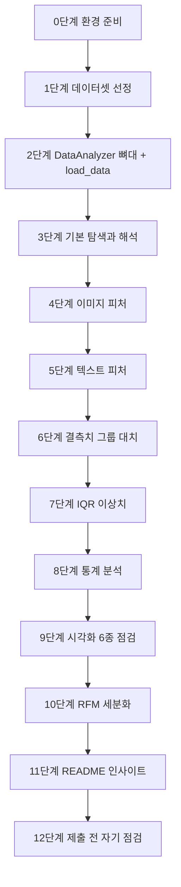

# A1-1 단계별 실습 가이드 — 이커머스 데이터 EDA와 RFM 단골 찾기

이 문서는 [A1-1 과제](../subject.md)를 환경 준비부터 제출까지 순서대로 진행하기 위한 안내서다. 각 단계는 **목표 / 할 일 / 힌트 / 확인 방법**으로 구성된다. 정답 코드는 없다. 막히는 개념은 [개념 정리](LEARNING_GUIDE.md)의 해당 절을 함께 읽는다.

> 표기 규칙: subject.md에 없는 제안은 **(권장)**으로 표시한다. 권장 사항은 하지 않아도 감점 요소가 아니다.

## 최종 결과물 구조

과제가 요구하는 파일은 세 가지다. 나머지는 작업하면서 자연스럽게 생기는 파일이다.

```text
A1-1/
├── src/
│   └── pipeline.py                  # 필수: DataAnalyzer 클래스
├── notebooks/
│   └── analysis_report.ipynb        # 필수: 시각화, 통계, RFM, 마크다운 해석
├── data/                            # (권장) 원본 데이터 위치
└── README.md                        # 필수: 개요, 데이터 설명, 인사이트 3개 이상, 실행 방법
```

## 진행 지도



예상 시간 배분(학습시간 60시간 기준, 참고용): 데이터 선정·이해 10시간, 파이프라인·전처리 20시간, 통계·시각화 12시간, RFM 10시간, README·정리 8시간.

---

## 0단계. 환경 준비

**목표**: 허용 라이브러리만 설치된 깨끗한 실습 환경을 만든다.

**할 일**

1. Python 버전을 확인한다(3.8 이상).
2. 프로젝트 폴더에 가상환경을 만들고 활성화한다.
3. NumPy, Pandas, Matplotlib, Seaborn과 노트북 실행 도구(Jupyter)를 설치한다.
4. 위 구조대로 `src/`, `notebooks/` 폴더를 만든다.

**힌트**

```bash
python3 --version
python3 -m venv .venv
source .venv/bin/activate
pip install numpy pandas matplotlib seaborn jupyter
```

- (권장) `pip freeze > requirements.txt`로 설치 목록을 남기면 README의 실행 방법을 쓰기 쉽다.
- (권장) `.gitignore`에 `.venv/`, `.ipynb_checkpoints/`를 넣는다.
- 보너스 3을 할 계획이 없다면 Plotly는 설치하지 않는다. 실수로 본 과제에 쓰는 것을 막을 수 있다.

**확인 방법**

- `python -c "import numpy, pandas, matplotlib, seaborn; print('ok')"`가 `ok`를 출력한다.
- `pip list`에 opencv, pillow를 직접 설치하지 않았다(Matplotlib는 필수 의존성으로 Pillow를 함께 설치하므로 `pip list`에 보이는 것은 정상이다. 코드에서 `import PIL`을 하지 않으면 된다).

---

## 1단계. 데이터셋 선정

**목표**: 과제의 데이터 조건을 모두 만족하는 데이터셋을 확보한다.

**할 일**: 아래 표를 채워 본다. 하나라도 "아니오"면 다른 데이터를 찾거나 데이터를 보강한다.

| 조건 (subject.md 4-1, 7) | 내 데이터 | 만족? |
| --- | --- | --- |
| 1,000건 이상 | | |
| 컬럼 8개 이상 | | |
| 수치형·범주형·날짜형·이미지(배열) 중 3가지 이상 | | |
| 상품명(텍스트) 컬럼 있음 (4-3 텍스트 피처용) | | |
| 이미지 데이터를 NumPy 배열로 만들 수 있음 (4-3 이미지 피처용) | | |
| RFM용 `customer_id`, `order_date`, `amount`(또는 price×qty) | | |
| 공개 라이선스 확인, 출처 기록 | | |

**힌트**

- 과제는 "Kaggle, AI Hub 등에서 수집하거나 **제공된 샘플**을 사용"하라고 한다. 코디세이에서 샘플을 제공한다면 그것이 가장 빠른 출발점이다.
- 상품 정보(이름·가격·카테고리·이미지)와 거래 정보(고객·주문일·금액)가 한 파일에 없을 수 있다. 상품 ID로 두 테이블을 `merge`해도 된다. 이때 각 테이블의 "1행이 무엇인지"를 먼저 정리한다([개념 정리 1.2절](LEARNING_GUIDE.md#12-데이터의-단위grain)).
- 이미지가 파일(PNG 등)로 있다면 `matplotlib.pyplot.imread()`로 읽는다. CSV 안에 문자열로 들어 있다면 `ast.literal_eval()` 또는 `np.fromstring()`으로 복구한다.
- 데이터 출처 URL과 라이선스를 지금 메모해 둔다. 나중에 찾으려면 어렵다.

**확인 방법**: 위 표가 모두 "예"이고, 출처·라이선스 메모가 있다.

---

## 2단계. `DataAnalyzer` 뼈대와 `load_data()`

**목표**: `src/pipeline.py`에 클래스 골격을 만들고, 노트북에서 불러와 데이터를 읽는다.

**할 일**

1. 필수 메서드 4개(`load_data`, `handle_missing_values`, `detect_outliers`, `calculate_rfm`)를 `pass`로 먼저 만든다.
2. 피처 엔지니어링·요약 통계용 메서드 자리도 만든다(이름 자유).
3. `load_data()`만 먼저 구현한다: 파일 읽기 → `self.df` 저장 → 날짜 컬럼 변환.
4. `notebooks/analysis_report.ipynb`를 만들고 클래스를 불러와 실행한다.

**힌트**: 뼈대 예시(구현은 직접 채운다)

```python
class DataAnalyzer:
    """이커머스 데이터 전처리, 피처 엔지니어링, 요약 통계, RFM을 수행한다."""

    def __init__(self, data_path):
        self.data_path = data_path
        self.df = None

    def load_data(self, date_cols=None):
        # TODO: 읽기, 날짜 변환, self.df 저장
        pass

    def add_image_features(self, image_col):      # 이름 자유
        pass

    def add_text_features(self, text_col):        # 이름 자유
        pass

    def handle_missing_values(self, strategy='group_median', group_col=None, columns=None):
        pass

    def detect_outliers(self, column, threshold=1.5):
        pass

    def calculate_rfm(self, customer_col, date_col, amount_col, reference_date=None):
        pass
```

- 노트북이 `notebooks/` 안에 있으므로 `sys.path.append("..")` 후 `from src.pipeline import DataAnalyzer`로 불러온다.
- `pipeline.py`를 고칠 때마다 노트북 커널을 재시작하기 귀찮으면 `%load_ext autoreload`, `%autoreload 2`를 노트북 첫 셀에 둔다.
- 요구사항 4-2: "주요 파라미터는 메서드 인자로" — 컬럼명, 임계값, 전략을 메서드 안에 하드코딩하지 않는다.

**확인 방법**

- 노트북에서 `analyzer = DataAnalyzer(...)`, `analyzer.load_data()` 후 `analyzer.df.shape`이 예상과 같다.
- `analyzer.df.dtypes`에서 날짜 컬럼이 `datetime64[ns]`다.

**흔한 실수**: 상대 경로 기준이 노트북 위치(`notebooks/`)라는 것을 잊고 `data/xxx.csv`로 적어 `FileNotFoundError`가 난다. `../data/xxx.csv`이거나 `pathlib`로 경로를 만든다.

---

## 3단계. 기본 탐색과 첫 해석

**목표**: `info()`, `describe()`, `head()`로 데이터 구조를 파악하고 마크다운 해석을 쓴다(요구사항 4-1).

**할 일**

1. 노트북에 "1. 데이터 개요" 마크다운 셀을 만든다(데이터 출처, 행·열 수, 컬럼 설명표).
2. `info()`, `describe()`, `head()`를 각각 실행한다.
3. 각 결과 아래에 해석 마크다운을 쓴다.
4. 데이터 유형별 컬럼을 표로 정리한다(수치/범주/날짜/텍스트/이미지).
5. Recency 기준일을 정하고 마크다운에 적는다(최종 거래일 또는 분석 기준일).

**힌트**

- 해석 공식: **수치 근거 1개 이상 + 시사점 1문장 이상**. 예: "`price`의 Non-Null이 9,412/10,000으로 588건(5.9%) 결측 → 6단계에서 카테고리별 대치가 필요하다."
- `describe()`에서 평균과 50%(중앙값)를 비교하면 치우침이 보인다([개념 정리 7절](LEARNING_GUIDE.md#7-기술통계-평균-중앙값-표준편차-사분위수)).
- 범주형은 `describe(include='object')` 또는 `value_counts()`로 본다.

**확인 방법**

- 해석 문단마다 숫자가 최소 1개 들어 있다.
- 해석 문단마다 "그래서 무엇을 할 것인가/주의할 것인가" 문장이 있다.
- 기준일이 노트북에 명시되어 있다.

---

## 4단계. 이미지 피처 (NumPy 벡터화)

**목표**: 각 상품 이미지의 평균(Mean)과 표준편차(Std)를 **반복문 없이** 계산해 새 컬럼으로 추가한다(요구사항 4-3).

**할 일**

1. 이미지를 NumPy 배열로 읽거나 복구한다.
2. 크기를 통일한다(크롭 또는 슬라이싱 다운샘플링).
3. 컬러라면 흑백으로 바꿀지, 채널별로 계산할지 정한다.
4. 모든 이미지를 하나의 배열 `(N, H, W)` 또는 `(N, H, W, C)`로 쌓는다.
5. 축을 지정한 배열 연산 한 번으로 평균·표준편차를 구해 컬럼으로 붙인다.

**힌트**

```python
imgs = np.stack(list_of_arrays)      # (N, H, W) — 모든 원소 shape이 같아야 함
small = imgs[:, ::2, ::2]            # 배치 전체를 한 번에 다운샘플링
# 평균/표준편차: imgs.mean(axis=...), imgs.std(axis=...) — 어떤 축일지 직접 정한다
```

- 이미지 파일을 읽거나 문자열을 복구하는 단계는 파일마다 처리해야 하므로 반복이 생긴다. 과제가 금지하는 것은 **통계 계산 단계의 for 문**이다. 계산 부분은 반드시 배열 연산으로 쓴다.
- 픽셀 값 범위(0~255 정수 vs 0~1 실수)를 통일한다. 섞여 있으면 평균이 의미가 없다.
- 이미지 행과 DataFrame 행의 순서가 같은지 꼭 확인한다. 순서가 어긋나면 엉뚱한 상품에 피처가 붙는다.
- OpenCV, Pillow 함수는 쓰지 않는다. 리사이즈는 `arr[::n, ::n]`.

**확인 방법**

- 새 컬럼(예: `img_mean`, `img_std`)의 길이가 DataFrame 행 수와 같다.
- 이미지 2~3장을 골라 `plt.imshow`로 띄워 보고, 밝은 이미지의 `img_mean`이 실제로 큰지 눈으로 확인한다.
- `pipeline.py`의 해당 메서드에 `for`가 통계 계산용으로 쓰이지 않았다.

---

## 5단계. 텍스트 피처

**목표**: 상품명에서 단어 수 또는 문자열 길이 파생 변수를 추가한다(요구사항 4-3).

**할 일**: 피처 메서드에서 상품명 컬럼을 인자로 받아 길이(또는 단어 수) 컬럼을 추가한다.

**힌트**: Pandas 문자열 접근자 `.str`을 쓴다(`.str.len()`, `.str.split()`). NLTK 같은 NLP 라이브러리는 금지다.

**확인 방법**

- 상품명 3개를 골라 손으로 센 값과 컬럼 값이 같다.
- 상품명이 결측인 행의 처리 방식(결측 유지 / 0)을 마크다운에 적었다.

---

## 6단계. 결측치 현황과 그룹별 대치

**목표**: 결측 현황을 보여 주고, GroupBy 통계로 대치하는 로직을 1가지 이상 적용한다(요구사항 4-4).

**할 일**

1. 컬럼별 결측 수와 비율을 표로 보여 준다.
2. 어떤 컬럼을 어떤 그룹 기준으로 채울지 정하고 이유를 쓴다(예: 가격은 카테고리별 중앙값).
3. `handle_missing_values()`에 전략과 그룹 컬럼을 인자로 받아 대치하는 로직을 구현한다.
4. 대치 전후 결측 수를 비교해서 보여 준다.

**힌트**

- 핵심 도구는 `groupby(...)[col].transform(...)` + `fillna(...)`다([개념 정리 6절](LEARNING_GUIDE.md#6-결측치와-그룹별-대치)).
- 그룹 전체가 결측이면 그룹 통계도 `NaN`이 된다. 남은 결측을 확인하고 대비책을 둔다.
- 이상치가 많은 컬럼이면 평균보다 중앙값이 안전하다.
- RFM에 쓰는 `customer_id`가 비어 있는 거래는 대치할 수 없다(누구 거래인지 모르므로). 어떻게 처리했는지 따로 적는다.

**확인 방법**

- 대치 후 대상 컬럼의 `isna().sum()`이 0(또는 의도한 값)이다.
- 대치 전후 그룹별 평균/중앙값이 크게 바뀌지 않았다.
- 전략 인자를 바꿔 호출하면 결과가 달라진다(인자가 실제로 쓰이는지 확인).

---

## 7단계. IQR 이상치 탐지와 처리 전후 비교

**목표**: IQR 로직을 직접 함수로 구현하고, 처리 전후 분포 변화를 박스플롯으로 보여 준다(요구사항 4-4, 4-6).

**할 일**

1. `detect_outliers(column, threshold)`를 구현한다. Q1, Q3, IQR, 경계를 직접 계산한다.
2. 주요 수치 컬럼 하나 이상에 적용해 이상치 개수와 비율을 출력한다.
3. 처리 방법(제거 / 클리핑 / 유지+표시)을 정하고 근거를 쓴다.
4. 처리 전후 박스플롯(그리고 가능하면 히스토그램)을 나란히 그린다.

**힌트**

- 공식: lower = Q1 - k·IQR, upper = Q3 + k·IQR ([개념 정리 8절](LEARNING_GUIDE.md#8-iqr-이상치-탐지)). subject.md의 결과 예시에 탐지 부분 예시가 있으니 그 구조를 이해한 뒤 처리(제거/클리핑) 로직은 직접 설계한다.
- 탐지 결과를 돌려주는 메서드와 실제로 처리하는 메서드를 분리하면 깔끔하다(권장).
- 처리 전 데이터를 복사해 두지 않으면 "처리 전" 박스플롯을 그릴 수 없다.
- 고액 구매 금액은 RFM의 Monetary에 중요한 정보다. RFM 계산에 쓸 금액 컬럼을 이상치 처리로 잘라 버릴지는 신중히 정한다.

**확인 방법**

- 함수가 돌려준 경계값을 손계산(Q1, Q3를 `quantile`로 출력해 직접 계산)과 비교해 일치한다.
- `threshold=1.5`와 `threshold=3.0`으로 호출했을 때 3.0일 때의 이상치 수가 1.5일 때보다 같거나 적다(더 많으면 경계 계산이 잘못된 것이다).
- 처리 전후 박스플롯에 제목과 축 레이블이 있다.

---

## 8단계. 통계 분석

**목표**: 주요 수치형 변수의 평균·중앙값·표준편차·사분위수를 계산하고, 2쌍 이상의 상관계수를 해석한다(요구사항 4-5).

**할 일**

1. 주요 수치형 변수(가격, 수량, 이미지 피처, 텍스트 피처 등)의 요약 통계표를 만든다. 요약 통계 메서드를 클래스에 두면 좋다.
2. 상관행렬을 계산한다.
3. 2쌍 이상을 골라 해석한다.

**힌트**

- `describe()` 결과에 평균, 표준편차, 25/50/75%가 모두 있다. 필요한 행만 골라 표로 정리해도 된다.
- 상관 해석 문장 예: "(가격, 이미지 표준편차)의 r = 0.12로 약한 양의 상관이다(근거). 이미지 대비만으로 가격대를 추정하기는 어렵다(시사점)."
- 상관을 인과로 쓰지 않는다([개념 정리 9절](LEARNING_GUIDE.md#9-상관계수)).

**확인 방법**

- 해석이 필요한 모든 통계량에 수치 근거와 시사점이 있다.
- 상관 해석이 2쌍 이상이다.

---

## 9단계. 시각화 6종 점검

**목표**: 여섯 가지 차트를 각각 1개 이상 갖추고, 모두 제목·축 레이블을 단다(요구사항 4-6).

**할 일**: 지금까지 그린 차트를 표에 표시하고, 빠진 것을 채운다.

| 차트 | 요구 용도 | 내 노트북 위치(셀 제목) |
| --- | --- | --- |
| 히스토그램 | 수치형 변수 분포 | |
| 박스플롯 | 이상치 처리 전후 비교 | 7단계 |
| 막대그래프 | 범주 빈도 또는 RFM 세그먼트별 고객 수 | |
| 히트맵 | 상관행렬 또는 RFM 세그먼트 분포 | |
| 산점도 | 두 수치형 변수 관계 | |
| 라인차트 | 시계열 추세(예: 월별 매출) | |

**힌트**

- 라인차트는 주문일을 월 단위로 묶어 금액을 합한 뒤 그린다(`dt.to_period('M')` 또는 `resample`).
- 히트맵은 `sns.heatmap(corr, annot=True)`처럼 숫자를 함께 표시하면 해석이 쉽다.
- 한글이 깨지면 `plt.rcParams['font.family']`에 한글 폰트를 지정한다.
- 각 차트 아래에 짧은 해석 마크다운을 단다(근거 + 시사점).

**확인 방법**: 표의 여섯 칸이 모두 채워졌고, 각 차트에 `title`, `xlabel`, `ylabel`이 있다.

---

## 10단계. RFM 계산과 고객 세분화

**목표**: 고객별 R·F·M 점수를 계산하고, 4개 이상 세그먼트로 나눈 뒤 특징을 분석한다(요구사항 4-7).

**할 일**

1. `calculate_rfm(customer_col, date_col, amount_col, ...)`을 구현한다.
   - 기준일(최종 거래일 또는 분석 기준일) 결정
   - 고객별 마지막 구매일, 구매 횟수, 총 금액 집계
   - R = 기준일 - 마지막 구매일(일 수)
2. 각 지표를 점수(예: 1~5)로 바꾼다.
3. 세그먼트 규칙을 표로 정의하고 마크다운에 적는다(최소 4개 그룹).
4. 세그먼트별 고객 수, 평균 R·F·M, 매출 비중을 표로 만든다.
5. 세그먼트별 고객 수 막대그래프, (권장) 세그먼트 × 점수 히트맵을 그린다.

**힌트**

```python
# 고객 단위 집계의 형태 (컬럼명은 인자로 받은 값을 사용)
# df.groupby(customer_col).agg(last_date=(date_col, 'max'), ...)
```

- 금액 컬럼이 없으면 `price * qty`로 먼저 만든다.
- 주문 번호가 있다면 Frequency는 고유 주문 수(`nunique`)로 세는 것이 정확하다.
- Recency 점수는 **작을수록 높은 점수**다. `pd.qcut(..., labels=[5,4,3,2,1])`처럼 거꾸로 준다.
- `qcut`이 "Bin edges must be unique"를 내면 `rank(method='first')`를 먼저 적용한다([개념 정리 12.3절](LEARNING_GUIDE.md#123-점수화-분위수quantile로-나누기)).
- 세그먼트 규칙은 "위에서부터 먼저 맞는 규칙 적용" 순서로 설계하면 한 고객이 두 그룹에 들어가는 문제를 피한다.
- 반품(음수 금액)이 있으면 처리 방침을 정한다.
- scikit-learn(K-Means 등)은 금지다. 점수 + 규칙으로 나눈다.

**확인 방법**

- 손 검증: 고객 2~3명을 골라 원본 거래를 필터링해 R, F, M을 직접 계산하고 결과와 비교한다.
- VIP 그룹의 평균 Recency가 Churned 그룹보다 **작다**(방향이 맞는지 확인).
- 모든 고객이 정확히 한 세그먼트에 속한다(세그먼트별 고객 수 합 = 전체 고객 수).
- 세그먼트가 4개 이상이고, 각 세그먼트의 특징이 숫자와 함께 서술되어 있다.

---

## 11단계. README 작성

**목표**: README에 필수 항목 4가지와 형식을 갖춘 인사이트 3개 이상을 쓴다(결과물 3, 요구사항 4-7, 4-8).

**할 일**: 아래 목차로 쓴다.

1. 프로젝트 개요 — 무엇을 왜 분석했는가
2. 데이터 설명 — 출처(링크), 라이선스, 행·열 수, 주요 컬럼, 데이터 유형, 기간
3. 비즈니스 인사이트 3개 이상 — RFM 세분화 결과 기반
4. 실행 방법 — 환경 설치, 데이터 위치, 노트북 실행 순서

**힌트**: 인사이트 하나마다 세 요소를 빠짐없이 쓴다.

| 요소 | 체크 |
| --- | --- |
| (근거) 수치/그래프 1개 이상 | 숫자가 있는가? 그래프라면 노트북의 어느 차트인가? |
| (실행) 대상 세그먼트 + 실행 방법 + 기대 효과 | 세 가지가 모두 있는가? |
| (검증) 추가로 필요한 데이터 또는 반증 가능성 1문장 | 있는가? |

- subject.md 8절의 인사이트 예시 형식을 참고하되, 숫자는 반드시 내 분석 결과에서 가져온다.
- (권장) 세그먼트 요약표(세그먼트 / 고객 수 / 평균 구매금액 / 특징)를 README에도 넣으면 근거로 인용하기 좋다.

**확인 방법**: 새 터미널에서 README의 실행 방법만 보고 따라 했을 때 노트북이 처음부터 끝까지 실행된다.

---

## 12단계. 제출 전 자기 점검

노트북은 **커널 재시작 후 전체 실행(Restart & Run All)**으로 오류 없이 끝나야 한다. 그 상태로 저장해서 차트 출력이 노트북에 남게 한 뒤 GitHub에 올리고 저장소 URL을 제출한다.

| subject.md 요구사항 | 어디서 확인하는지 |
| --- | --- |
| 2-1 `src/pipeline.py`, OOP 구조 | 파일 존재, 계산 로직이 클래스 메서드 안에 있음 |
| 2-2 `notebooks/analysis_report.ipynb`, 단계마다 마크다운 | 노트북 목차, 각 섹션 마크다운 셀 |
| 2-3 README: 개요, 데이터 설명, 인사이트 3개 이상, 실행 방법 | README 목차 |
| 4-1 1,000건 이상, 8컬럼 이상 | 노트북 `info()` 출력 |
| 4-1 데이터 유형 3가지 이상 | 노트북 데이터 유형 정리표 |
| 4-1 `info()`, `describe()`, `head()` + 해석 | 3단계 셀과 마크다운 |
| 4-1 RFM용 `customer_id`, `order_date`, `amount` | RFM 섹션 입력 컬럼 |
| 4-1 Recency 기준일 정의 | RFM 섹션 마크다운 |
| 4-1, 4-5 해석마다 수치 근거 + 시사점 | 모든 해석 마크다운 |
| 4-2 `DataAnalyzer` 클래스, 4개 메서드 | `pipeline.py`에서 메서드 이름 검색 |
| 4-2 주요 파라미터를 인자로 | `detect_outliers`의 임계값, `handle_missing_values`의 전략 인자 |
| 4-3 이미지 평균·표준편차 컬럼, for 문 없이 | 해당 메서드 코드, 새 컬럼 |
| 4-3 상품명 단어 수 또는 길이 컬럼 | 새 컬럼 |
| 4-4 결측 현황 + 그룹별 대치 1가지 이상 | 6단계 셀 |
| 4-4 IQR 함수 직접 구현 + 처리 전후 분포 시각화 | `detect_outliers`, 7단계 차트 |
| 4-5 평균·중앙값·표준편차·사분위수 + 해석 | 8단계 표 |
| 4-5 상관계수 2쌍 이상 + 해석 | 8단계 마크다운 |
| 4-6 차트 6종, 모두 제목·축 레이블 | 9단계 점검표 |
| 4-7 R·F·M 점수, 4개 이상 세그먼트, 특징 분석 | 10단계 표와 차트 |
| 4-7, 4-8 README 인사이트 3개 이상, 근거·실행·검증 | README 인사이트 절 |
| 6 허용 라이브러리만 사용 | `import` 문 검색: cv2, PIL, sklearn, nltk, pandas_profiling, sweetviz, plotly(보너스 3 외) 없음 |
| 7 데이터 출처·라이선스 명시 | README 데이터 설명 |

금지 라이브러리 확인 예시:

```bash
grep -rnE "import (cv2|PIL|sklearn|nltk|sweetviz|ydata_profiling|pandas_profiling)|from (PIL|sklearn|nltk)" src notebooks
```

---

## 자주 하는 실수 모음

| 증상 | 원인 | 해결 |
| --- | --- | --- |
| 날짜끼리 빼기에서 `TypeError` | 날짜가 아직 문자열 | `load_data`에서 `pd.to_datetime` 변환 |
| `np.stack`이 shape 오류 | 이미지 크기가 제각각 | 먼저 크롭/다운샘플링으로 통일 |
| 이미지 피처가 엉뚱한 상품에 붙음 | 이미지 순서와 DataFrame 순서 불일치 | 상품 ID 기준으로 정렬/매칭 확인 |
| VIP의 Recency가 가장 큼 | R 점수 방향 반대 | R은 작을수록 높은 점수 |
| `qcut` "Bin edges must be unique" | F 값 동점이 많음 | `rank(method='first')` 후 `qcut` |
| 노트북을 다시 열면 결과가 다름 | 셀 실행 순서 꼬임 | Restart & Run All로 확인 |
| 한글이 네모로 표시 | 폰트 미지정 | `rcParams['font.family']` 지정 |
| "처리 전" 박스플롯이 처리 후와 같음 | 원본을 덮어씀 | 처리 전 복사본 보관 |
| 해석이 "많다/적다"뿐 | 수치 근거 누락 | 해석마다 숫자 1개 이상 |
| 인사이트 (실행)이 막연함 | 대상 세그먼트·기대 효과 누락 | 세 요소 체크표로 점검 |

---

## 보너스 과제 (선택)

본 과제를 모두 끝낸 뒤에 시도한다. 아래는 힌트만 제공한다.

### 보너스 1. 이미지 고급 피처

- **히스토그램 피처**: 픽셀 밝기를 몇 개 구간(bin)으로 나눠 각 구간 비율을 피처로 쓴다. `np.histogram`은 1차원 배열 하나씩 처리하므로, 배치 전체를 한 번에 처리하고 싶다면 "픽셀 값을 구간 번호로 바꾼 뒤(정수 나눗셈 등) 구간별로 세는" 방식을 배열 연산으로 설계해 본다.
- **간단한 엣지 특성**: 이웃 픽셀 간 차이 `np.diff(imgs, axis=...)`의 절댓값 평균은 "윤곽이 얼마나 많은가"를 나타낸다. 가로·세로 방향을 각각 계산해 볼 수 있다.
- 새 피처가 기존 피처(평균·표준편차)와 얼마나 상관이 있는지 확인하면 "새로운 정보를 주는가"를 판단할 수 있다.

### 보너스 2. 코호트 분석

- 과제는 "**가입 월별** 고객의 재구매율"을 요구한다. 가입일 컬럼이 없다면 "첫 구매 월"을 코호트 기준으로 쓰고, 그렇게 정의했다고 명시한다.
- 흐름: 고객별 코호트 월 → 각 거래의 "코호트 이후 경과 개월 수" → (코호트 월 × 경과 개월) 고객 수 표 → 0개월 고객 수로 나눠 비율 → `sns.heatmap`.
- 경과 개월 수는 (연 차이 × 12 + 월 차이)로 계산할 수 있다.

### 보너스 3. Plotly 인터랙티브 시각화

- **이 보너스에서만** Plotly가 허용된다. 본 과제 차트 6종은 Matplotlib/Seaborn으로 그린 것이 따로 있어야 한다.
- RFM 세그먼트를 R·F·M 축 3D 산점도나, 세그먼트별 고객 수 막대 차트에 마우스 오버 정보를 붙이는 식으로 표현해 본다.
- GitHub에서는 노트북의 Plotly 차트가 보이지 않을 수 있다. (권장) 정적 이미지나 HTML 파일로 함께 남기는 방법을 고려한다.
